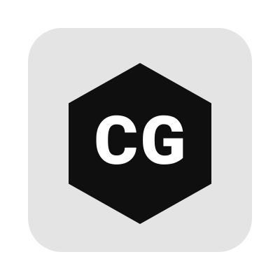

<p align="center">
  
</p>

<h1 align="center">CGame++</h1>

<p align="center">
  <b>Motor de videojuegos 2D en C++20 con renderizado Vulkan</b><br>
  La simplicidad de <code>pygame</code> con el rendimiento nativo de la GPU.
</p>

<p align="center">
  <a href="https://github.com/aminbena010-ai/CGame/blob/main/LICENSE"></a>
  
  
  
  
</p>

<p align="center">
  <a href="#inicio-rápido">Inicio rápido</a> ·
  <a href="#características">Características</a> ·
  <a href="#compilación">Compilación</a> ·
  <a href="#documentación">Documentación</a> ·
  <a href="#contribuir">Contribuir</a>
</p>

---

## ¿Qué es CGame++?

**CGame++** es un motor y framework de videojuegos 2D **de código abierto**, escrito en **C++20** y renderizado con **Vulkan**. Ofrece una API minimalista inspirada en [`pygame`](https://www.pygame.org/) para crear ventanas, cargar sprites, dibujar texto, reproducir sonidos y detectar colisiones con muy pocas líneas de código — pero con el **rendimiento nativo de la GPU** y el control total que da C++.

Es la alternativa **libre y de alto rendimiento** a los motores basados en JavaScript (Phaser, PixiJS, Kaboom.js, Babylon.js) para desarrolladores que necesitan:

- **Control de memoria** y del ciclo de vida de los recursos.
- **Rendimiento predecible** sin la sobrecarga del runtime de JavaScript.
- **Un binario nativo** sin empaquetar un navegador.
- **Una licencia permisiva (MIT)** sin ataduras comerciales.

> **Estado:** beta temprana. La API de los ejemplos incluidos es estable. Consulta [`CHANGELOG.md`](CHANGELOG.md) antes de actualizar entre versiones menores.

---

## ¿Por qué CGame++ en lugar de un motor en JavaScript?

| Característica | **CGame++** (C++20 + Vulkan) | Motores típicos en JS |
| :--- | :--- | :--- |
| **Rendimiento** | Nativo, acceso directo a la GPU | Depende del navegador (WebGL/Canvas) |
| **Gestión de memoria** | Manual / RAII, control total | Recolector de basura del runtime |
| **Distribución** | Un único ejecutable nativo | Servidor + navegador / Electron |
| **Lenguaje** | C++ moderno (C++20) | JavaScript / TypeScript |
| **Dependencias** | Mínimas (GLFW, Vulkan SDK) | `node_modules` del ecosistema npm |
| **Latencia de entrada** | Unas pocas decenas de µs | Variable según el navegador |
| **Licencia** | **MIT** (libre uso comercial) | Varía según el motor |
| **Curva de aprendizaje** | Familiar si vienes de `pygame` | Familiar si vienes de la web |

---

## Características

- 🪟 **Ventanas y contexto** gestionados con [GLFW](https://www.glfw.org/).
- 🎨 **Renderizado 2D con Vulkan** — sprites, texto y primitivas con aceleración por hardware.
- 🖼️ **Texturas** — carga de imágenes con [`stb_image`](https://github.com/nothings/stb).
- 🔤 **Fuentes TTF** — atlas de glifos generado con [`stb_truetype`](https://github.com/nothings/stb).
- 🔊 **Audio** — efectos y música en streaming con [`miniaudio`](https://miniaud.io/).
- ⌨️ **Entrada** — teclado, ratón y eventos de cierre.
- 📐 **Matemáticas 2D** — `Vector2` y `Rect` con colisiones tipo `pygame` (`colliderect`, `collidepoint`).
- ⏱️ **Bucle de juego** — `Clock` con delta time y límite de FPS.
- 🎮 **Ejemplos funcionales** — **Flappy Bird** y **Pong** listos para ejecutar.
- 📦 **Dependencias ligeras** — GLFW se descarga automáticamente vía `FetchContent` de CMake.

---

## Inicio rápido

```cpp
#include <CGame/CGame.hpp>

int main() {
    cg::init();
    {
        cg::Window window("Mi primer juego", 800, 600);
        cg::Clock  clock;
        cg::Texture sprite("assets/bird.png");
        cg::Font   font("assets/font.ttf", 24);

        cg::Vector2 position = {100.0f, 100.0f};

        while (window.isOpen()) {
            float dt = clock.getDeltaTime();

            cg::Event event;
            while (window.pollEvent(event)) {
                if (event.type == cg::EventType::Quit) {
                    window.close();
                }
                if (event.type == cg::EventType::KeyDown &&
                    event.key  == cg::Key::Space) {
                    position.y -= 50.0f;
                }
            }

            window.clear(cg::Color(30, 30, 40));
            cg::Renderer::drawSprite(sprite, position);
            cg::Renderer::drawText(font, "Hola CGame++",
                                   cg::Color::White, {20.0f, 20.0f});
            window.display();
            clock.tick(60);
        }
    }
    cg::quit();
    return 0;
}
```

Como ves, si vienes de `pygame` te sentirás como en casa: `init()` / `quit()`, un objeto `Window`, un `Clock` para el delta time y llamadas de dibujo estáticas en `Renderer`.

---

## Requisitos

| Herramienta | Versión mínima | Notas |
| :--- | :--- | :--- |
| **CMake** | 3.20 | |
| **Compilador C++** | C++20 | GCC 10+, Clang 12+ o MSVC 19.29+ |
| **Vulkan SDK** | 1.2+ | Debe incluir el compilador `glslc` |
| **Git** | cualquiera | Necesario para `FetchContent` (GLFW) |

En **Debian / Ubuntu**:

```bash
sudo apt install build-essential cmake git libvulkan-dev vulkan-tools glslc
```

> Si `glslc` no está en los repositorios de tu distribución, instala el **Vulkan SDK** desde <https://vulkan.lunarg.com/>.

---

## Compilación

```bash
git clone https://github.com/aminbena010-ai/CGame.git
cd CGame
cmake -S . -B build
cmake --build build -j
```

Los **shaders** se compilan automáticamente a SPIR-V en `build/shaders/`, y la carpeta `assets/` se copia al directorio de compilación.

### Ejecutar los ejemplos

```bash
./build/flappy_bird
./build/pong
```

---

## Estructura del proyecto

```text
CGame/
├── CMakeLists.txt          # Configuración de compilación y dependencias
├── include/CGame/          # Cabeceras públicas del motor
│   ├── CGame.hpp           # Cabecera paraguas (incluye todo)
│   ├── Core/               # Ventana, eventos y reloj
│   ├── Graphics/           # Renderer, texturas, fuentes, colores y dibujo
│   ├── Math/               # Vector2 y Rect
│   └── Audio/              # Sound y Music
├── src/                    # Implementación del motor
├── shaders/                # Shaders GLSL (vértice y fragmento)
├── examples/               # Juegos de ejemplo (Flappy Bird y Pong)
├── assets/                 # Recursos de ejemplo (imágenes, fuente y audio)
├── thirdparty/             # Librerías embebidas (stb_image, stb_truetype, miniaudio)
└── docs/                   # Documentación detallada
```

---

## Documentación

- 📘 [Índice de documentación](docs/README.md)
- ⚙️ [Instalación y compilación](docs/instalacion.md)
- 🏗️ [Arquitectura del motor](docs/arquitectura.md)
- 📚 [Referencia de la API](docs/api.md)
- 🎮 [Ejemplos y guía de uso](docs/ejemplos.md)
- 🤝 [Cómo contribuir](docs/contribuir.md)
- 🌐 [Wiki del proyecto](wiki.md)

---

## Créditos y dependencias

- [GLFW](https://www.glfw.org/) — ventanas y entrada.
- [Vulkan](https://www.vulkan.org/) — API gráfica.
- [stb](https://github.com/nothings/stb) — carga de imágenes y fuentes.
- [miniaudio](https://miniaud.io/) — audio.

---

## Contribuir

Las contribuciones son bienvenidas. Antes de abrir un PR, lee [`docs/contribuir.md`](docs/contribuir.md) para conocer el flujo de trabajo, las convenciones de código y cómo reportar problemas.

Formas rápidas de ayudar:

- ⭐ **Dale una estrella** al repositorio — ayuda muchísimo a la visibilidad.
- 🐛 **Reporta bugs** con un [issue reproducible](https://github.com/aminbena010-ai/CGame/issues/new).
- 📝 **Mejora la documentación** — cualquier corrección es bienvenida.
- 🎮 **Comparte tu juego** hecho con CGame++ en la sección de [Discussions](https://github.com/aminbena010-ai/CGame/discussions).

---

## Licencia

CGame++ se distribuye bajo la licencia **MIT**. Consulta [LICENSE](LICENSE) para más información. Puedes usar, modificar, distribuir y licenciar el proyecto libremente, manteniendo el aviso de copyright.

---

<p align="center">
  Hecho con ☕ y C++20 por <a href="https://github.com/aminbena010-ai">@aminbena010-ai</a> y colaboradores.<br>
  <sub>Si CGame++ te resulta útil, considera darle una ⭐ al repositorio.</sub>
</p>
