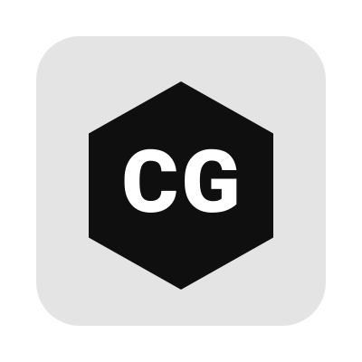

# Comunidad de CGame++

<p align="center">
  
</p>

<p align="center">
  <b>Un motor hecho por y para la comunidad.</b><br>
  <sub>CGame++ no es solo código: es un grupo de personas que quieren un motor 2D nativo, ligero y libre.</sub>
</p>

<p align="center">
  <a href="#-bienvenido">Bienvenido</a> ·
  <a href="#-código-de-conducta">Código de conducta</a> ·
  <a href="#-canales">Canales</a> ·
  <a href="#-cómo-participar">Cómo participar</a> ·
  <a href="#-reconocimiento">Reconocimiento</a> ·
  <a href="#-showcase">Showcase</a> ·
  <a href="#-gobernanza">Gobernanza</a>
</p>

---

## 👋 Bienvenido

Tanto si llevas años programando motores como si acabas de escribir tu primer `main()`, **este proyecto tiene un hueco para ti**. CGame++ nació de una idea sencilla: *"¿y si pudiéramos tener la simplicidad de `pygame` con el rendimiento nativo de C++ y Vulkan?"*. La respuesta no la da un solo desarrollador — la da una comunidad.

Esta página es tu **punto de entrada a esa comunidad**. Aquí encontrarás:

- Dónde hablar con otras personas que usan CGame++.
- Cómo contribuir, aunque no sepas C++ o Vulkan.
- Qué normas hacen que este espacio sea respetuoso y productivo.
- Cómo se reconocen las contribuciones.
- Cómo se toman las decisiones sobre el futuro del proyecto.

> **¿Nuevo por aquí?** Lee esta página entera (son 5 minutos), luego únete a [Discussions](https://github.com/aminbena010-ai/CGame/discussions) y preséntate en el hilo *"👋 Preséntate"*. No hace falta decir nada épico: con un *"hola, vengo de X y quiero hacer Y"* basta.

---

## 🤝 Código de conducta

CGame++ adopta el [Contributor Covenant v2.1](https://www.contributor-covenant.org/version/2/1/code_of_conduct/) como norma de convivencia. En resumen:

### Lo que esperamos

- **Respeto ante todo.** Critica ideas, no personas.
- **Paciencia con quien empieza.** Todos fuimos novatos. Si alguien pregunta algo "básico", la respuesta correcta es ayudar, no ridiculizar.
- **Asumir buena fe.** La mayoría de los malentendidos en texto son eso: malentendidos.
- **Aceptar crítica técnica.** Si tu PR recibe comentarios, no es un ataque — es revisión.
- **Discreción con datos personales.** No publiques correos, direcciones ni capturas con información de otros sin permiso.

### Lo que NO se tolera

- Acoso, insultos, comentarios despectivos por identidad (género, orientación, etnia, religión, discapacidad, edad).
- Spam, autopromoción agresiva o publicidad encubierta.
- Compartir material con copyright sin atribución o sin permiso.
- **Conducta sexual inapropiada** en cualquier espacio del proyecto.
- Ataques personales, doxxing, o "pile-on" contra alguien.

### Aplicación

Si presencias o sufres una violación del código:

1. **Contacta con los maintainers** por correo: `conduct@cgame.dev` (o abre un issue privado si prefieres).
2. La queja se trata **en confidencialidad**, con respuesta en un plazo máximo de **7 días**.
3. Las sanciones van desde una **advertencia privada** hasta el **baneo permanente** del proyecto, según gravedad y reincidencia.
4. Cualquier maintainer involucrado en el conflicto se abstiene de participar en la decisión.

> La versión completa del código de conducta (con el texto oficial del Contributor Covenant y el procedimiento de escalado) está en [`CODE_OF_CONDUCT.md`](../CODE_OF_CONDUCT.md).

---

## 💬 Canales

Nos organizamos en canales distintos según el tipo de conversación. **Elige el más adecuado** antes de publicar: ayuda a que las preguntas no se pierdan.

### GitHub

| Canal | Para qué sirve | Tiempo medio de respuesta |
| :--- | :--- | :--- |
| 💬 [**Discussions**](https://github.com/aminbena010-ai/CGame/discussions) | Preguntas abiertas, ideas, showcase, encuestas | 1–3 días |
| 🐛 [**Issues**](https://github.com/aminbena010-ai/CGame/issues) | Bugs reproducibles y peticiones de features concretas | 3–7 días |
| 🔧 [**Pull Requests**](https://github.com/aminbena010-ai/CGame/pulls) | Código y documentación para revisar | 1–7 días |
| 📖 [**Wiki**](../wiki.md) | Manual completo y recetario | — |

### Discord *(servidor comunitario)*

| Canal | Para qué sirve |
| :--- | :--- |
| `#general` | Charla libre sobre CGame++, gamedev y C++ |
| `#ayuda` | Preguntas rápidas que no merecen un issue |
| `#showcase` | Enseña lo que estás haciendo |
| `#dev` | Coordinación entre contribuidores del motor |
| `#offtopic` | Memes, música, café ☕ |

**Invitación:** [discord.gg/cgame](https://discord.gg/cgame) *(enlace simbólico — reemplázalo por el real)*

> 💡 **Regla del canal `#ayuda`:** pega siempre el *código mínimo reproducible* y el *error exacto*. Sin eso, la respuesta más probable es *"falta contexto"*.

### Otros espacios

| Espacio | Uso |
| :--- | :--- |
| 🐦 **Twitter/X** [`@cgamepp`](https://twitter.com/cgamepp) | Anuncios de versiones y retweets de la comunidad |
| 🦋 **Bluesky** [`@cgame.dev`](https://bsky.app/profile/cgame.dev) | Lo mismo, para quien no usa X |
| 📝 **Blog** [cgame.dev/blog](https://cgame.dev/blog) | Artículos técnicos (Vulkan, C++20, arquitectura) |
| 🎥 **YouTube** | Charlas y tutoriales (por confirmar) |

---

## 🛠️ Cómo participar

**Contribuir no es solo escribir código.** Hay muchas formas de ayudar, todas valiosas.

### 🐛 Reportar bugs (cualquier persona)

Un buen reporte de bug vale más que cien PRs pequeños.

**Plantilla mínima:**

```markdown
**Entorno**
- CGame++: 0.1.0-beta
- SO: Ubuntu 24.04 / Windows 11 / macOS 15
- Compilador: GCC 13.2 / MSVC 19.38 / Clang 17
- Vulkan SDK: 1.3.283
- GPU: (opcional, si es problema gráfico)

**Qué intentabas hacer**
Descripción breve en 1-2 frases.

**Cómo reproducirlo**
1. Paso 1
2. Paso 2
3. ...

**Código mínimo**
```cpp
// 20-40 líneas como máximo
```

**Resultado esperado**
Qué creías que iba a pasar.

**Resultado real**
Qué pasó de verdad. Incluye el mensaje exacto de error y el stack trace si lo hay.
```

Abre el issue en [github.com/aminbena010-ai/CGame/issues/new](https://github.com/aminbena010-ai/CGame/issues/new).

### 📝 Mejorar la documentación (cualquier persona)

La documentación siempre está incompleta. Cosas útiles:

- Corregir una errata en un `.md`.
- Añadir un ejemplo que te costó sacar.
- Documentar una función pública sin comentarios.
- Traducir el README a tu idioma (ya hay ES, EN; faltan más).

**No necesitas permiso** para abrir un PR sobre `docs/` o cualquier `.md` — si mejora, se acepta.

### 🎨 Compartir tu trabajo (cualquier persona)

Cada juego publicado con CGame++ es un caso de uso real que nos ayuda a todos. Compártelo en:

- El canal `#showcase` de Discord.
- Discussions → categoría *"Showcase"*.
- Twitter con `#CGamePP` y `#gamedev`.

Y si puedes, añade el badge al README de tu juego:

```markdown
[](https://github.com/aminbena010-ai/CGame)
```

### 🧪 Probar versiones beta (intermedio)

Cada release candidate se anuncia en `#dev`. **Instálala en un proyecto real tuyo** y cuéntanos qué se rompe. Los bugs encontrados en beta son los que nunca llegan a producción.

### 💻 Contribuir código (intermedio → avanzado)

Antes de escribir tu primer PR al motor, lee [`docs/contribuir.md`](contribuir.md). Resumen rápido:

1. **Abre un issue primero** o comenta en uno existente. Evita PRs "sorpresa" de más de 100 líneas.
2. **Fork + rama** desde `main`:
   ```bash
   git checkout -b feat/mi-cambio
   ```
3. **Convenciones de commit** ([Conventional Commits](https://www.conventionalcommits.org/)):
   - `feat:` nueva funcionalidad
   - `fix:` corrección de bug
   - `docs:` documentación
   - `refactor:` cambio interno sin cambio de comportamiento
   - `test:` tests
   - `chore:` build, CI, deps
4. **Un PR = un cambio.** Si arreglas dos cosas, abre dos PRs.
5. **Añade test** si el cambio toca lógica (a partir de `0.2.0` el CI exige cobertura mínima).
6. **Sigue el estilo:** `camelCase` para métodos, `PascalCase` para tipos, `#pragma once`, C++20.
7. **Rellena la plantilla del PR** — sin ella, los maintainers no revisan.

### 🌍 Traducir (cualquier persona)

Actualmente en español e inglés. Idiomas objetivo:

- 🇫🇷 Francés
- 🇩🇪 Alemán
- 🇧🇷 Portugués (BR)
- 🇯🇵 Japonés
- 🇨🇳 Chino simplificado

Para empezar una traducción, abre un issue con la etiqueta `i18n` y el idioma. Los archivos a traducir son los de `docs/` y `wiki.md`.

### 🎨 Diseño gráfico (cualquier persona)

- Logos, banners, iconos para las releases.
- Capturas de pantalla y GIFs para la documentación.
- Temas visuales para la demo y los ejemplos.

### 🗣️ Difundir (cualquier persona)

- Escribe sobre CGame++ en tu blog.
- Mencionar el proyecto en foros (r/cpp, r/gamedev, Hacker News).
- Dar una charla en un meetup local.

### 💰 Patrocinar (opcional)

CGame++ es y será **gratis** y **MIT**. Si quieres apoyar económicamente:

- [GitHub Sponsors](https://github.com/sponsors/aminbena010-ai)
- [Open Collective](https://opencollective.com/cgame) *(por confirmar)*

Los fondos van a: infraestructura de CI, dominio y hosting de la web, y compensación puntual a contribuidores por trabajo grande (nunca para "comprar" decisiones técnicas).

---

## 🏆 Reconocimiento

La comunidad es lo que es gracias a las personas que aportan. CGame++ reconoce a sus contribuidores así:

### All Contributors

Usamos la especificación [All Contributors](https://allcontributors.org/). **Toda contribución cuenta:** código, docs, diseño, ideas, difusión, revisión, preguntas respondidas. La lista se actualiza automáticamente y se muestra en el README.

### Hall of Fame

Cada release incluye en sus notas un apartado *"Gracias a"* con las personas que han aportado desde la release anterior, con enlaces a sus perfiles.

### Maintainers honorarios

Quien mantiene un subsistema (audio, gráficos, build, docs…) durante al menos **dos releases consecutivos** recibe el título de *maintainer honorario* y se le menciona en `AUTHORS.md`.

### Badge de contribuidor

A partir de 3 PRs mergeados, se añade automáticamente el badge `cg-contributor` en tu perfil de Discussions.

### Créditos en el código

Los cambios significativos incluyen el nombre del autor en el mensaje de merge, y en el CHANGELOG cuando se trata de features o fixes importantes.

---

## 🎮 Showcase

Aquí van algunos juegos y proyectos hechos con CGame++. Si has hecho algo con el motor, **abre un PR** añadiendo tu proyecto a esta lista.

| Proyecto | Autor | Descripción | Enlace |
| :--- | :--- | :--- | :--- |
| **Flappy Bird** (ejemplo) | @aminbena010-ai | El clásico, incluido en el repo | [`examples/flappy_bird/`](../examples/flappy_bird/) |
| **Pong** (ejemplo) | @aminbena010-ai | Pong con audio, incluido en el repo | [`examples/pong/`](../examples/pong/) |
| *Tu juego aquí* | — | — | — |

### Plantilla para añadir tu proyecto

```markdown
| **Nombre** | @usuario | Descripción breve (1 línea) | [repo](https://...) o [demo](https://...) |
```

> 💡 Si tu proyecto tiene capturas, súbelas a `assets/showcase/` del repo y enlázalas en el README de tu propio proyecto.

---

## 🏛️ Gobernanza

CGame++ sigue un modelo **BDFL** (*Benevolent Dictator For Life*) mientras el proyecto es joven, con vocación de evolucionar a un modelo de **maintainers** cuando haya ≥3 personas con commits regulares durante ≥6 meses.

### Roles actuales

| Rol | Persona(s) | Responsabilidad |
| :--- | :--- | :--- |
| **Autor / BDFL** | [@aminbena010-ai](https://github.com/aminbena010-ai) | Decisión final sobre API pública y rumbo del proyecto |
| **Maintainers** | *(por confirmar)* | Revisión de PRs, gestión de issues, releases |
| **Triagers** | *(por confirmar)* | Etiquetar issues y redirigir a la persona adecuada |

### Cómo se toman las decisiones

| Tipo de decisión | Quién decide | Cómo |
| :--- | :--- | :--- |
| **Bug fix** | Cualquier maintainer | Un revisor aprueba el PR |
| **Nueva feature pequeña** | Un maintainer | Un revisor aprueba el PR |
| **Feature grande / cambio de API** | BDFL + maintainers | RFC abierto en Discussions durante 2 semanas |
| **Cambio de licencia** | BDFL | Requiere consenso de todos los contribuidores vivos |
| **Expulsión de un miembro** | Maintainers | Por consenso de 2/3 |

### RFCs (Request for Comments)

Cambios que afectan a la API pública se discuten en un **RFC**. Plantilla:

```markdown
# RFC-000N: Título

## Motivación
¿Por qué hace falta este cambio?

## Propuesta
¿Qué se propone exactamente? (API, firma, comportamiento)

## Alternativas consideradas
¿Qué otras opciones se han evaluado?

## Impacto
- ¿Rompe compatibilidad? ¿Cómo migrar?
- ¿Cambia el rendimiento?
- ¿Añade dependencias?

## Cronograma
- Fecha de apertura: YYYY-MM-DD
- Fecha de cierre: YYYY-MM-DD
- Decisión: pendiente / aceptado / rechazado
```

Los RFCs viven en `rfcs/` del repositorio. Aprobación por consenso de maintainers + BDFL.

### Estabilidad de la API

- **`0.x.y`** → la API puede cambiar entre `minor` releases. Se documentan los *breaking changes* en `CHANGELOG.md`.
- **`1.0.0`** → la API se congela. Los cambios incompatibles solo en `2.0.0`, con al menos un `minor` de deprecación previo.

---

## 🎯 Lo que la comunidad pide

*(Actualizado periódicamente a partir de las encuestas en Discussions y los issues más votados con 👍)*

| Prioridad | Petición | Estado |
| :--- | :--- | :--- |
| 🔴 Alta | Cámara 2D con zoom y rotación | En desarrollo (`0.2.0`) |
| 🔴 Alta | Texto multilínea con wrapping | En desarrollo (`0.2.0`) |
| 🟡 Media | Tilemaps (Tiled TMX) | Planificado (`0.3.0`) |
| 🟡 Media | Sistema de partículas | Planificado (`0.4.0`) |
| 🟡 Media | Soporte Android | Planificado (`0.4.0`) |
| 🟢 Baja | Editor visual de escenas | Sin fecha |
| 🟢 Baja | Integración con Lua | Sin fecha |
| 🟢 Baja | Soporte para Nintendo Switch | Sin fecha (requiere NDA) |

> **Tu voto cuenta.** En Discussions hay hilos con encuestas. Los issues con más 👍 suben en la columna de prioridad del [roadmap](https://github.com/aminbena010-ai/CGame/projects).

---

## 🌟 Cómo empezar hoy mismo

Una lista corta de acciones, de menor a mayor implicación:

- ⭐ **Dale una estrella al repo.** 30 segundos. Ayuda muchísimo a la visibilidad.
- 👋 **Preséntate en Discussions.** Di quién eres y qué te trae por aquí.
- 🐛 **Reporta un bug que hayas encontrado.** Con la plantilla de arriba.
- 📝 **Corrige una errata en un `.md`.** PRs de 1 línea son bienvenidos.
- 💬 **Responde una pregunta en `#ayuda`.** Compartir lo que sabes es contribuir.
- 🎮 **Comparte tu juego en `#showcase`.** Aunque sea un prototipo feo, nos interesa.
- 💻 **Abre tu primer PR de código.** Lee [`docs/contribuir.md`](contribuir.md) primero.
- 🌍 **Traduce una sección.** Abre un issue con `i18n`.
- 💰 **Patrocina si puedes.** No es obligatorio, pero se agradece.

---

## 📬 Contacto directo

| Asunto | Contacto |
| :--- | :--- |
| Bugs / features | [GitHub Issues](https://github.com/aminbena010-ai/CGame/issues/new) |
| Preguntas generales | [GitHub Discussions](https://github.com/aminbena010-ai/CGame/discussions) |
| Charla rápida | [Discord](https://discord.gg/cgame) |
| Código de conducta | `conduct@cgame.dev` |
| Seguridad | `security@cgame.dev` (ver [`SECURITY.md`](../SECURITY.md)) |
| Prensa / colaboraciones | `hello@cgame.dev` |

---

## 🔗 Enlaces útiles

- 📖 [README principal](../README.md)
- 📚 [Wiki (hub de documentación)](../wiki.md)
- 📘 [API completa](api.md)
- 🏗️ [Arquitectura del motor](arquitectura.md)
- 🤝 [Cómo contribuir (detalle)](contribuir.md)
- 🎮 [Ejemplos y guía de uso](ejemplos.md)
- 📜 [Código de conducta completo](../CODE_OF_CONDUCT.md)
- 🔒 [Política de seguridad](../SECURITY.md)
- 📝 [Historial de cambios](../CHANGELOG.md)

---

<p align="center">
  <sub><b>Un motor no es un repositorio. Es la gente que lo usa.</b><br>
  Gracias por estar aquí. 🌱</sub>
</p>

<p align="center">
  <a href="https://github.com/aminbena010-ai/CGame">
    
  </a>
</p>
